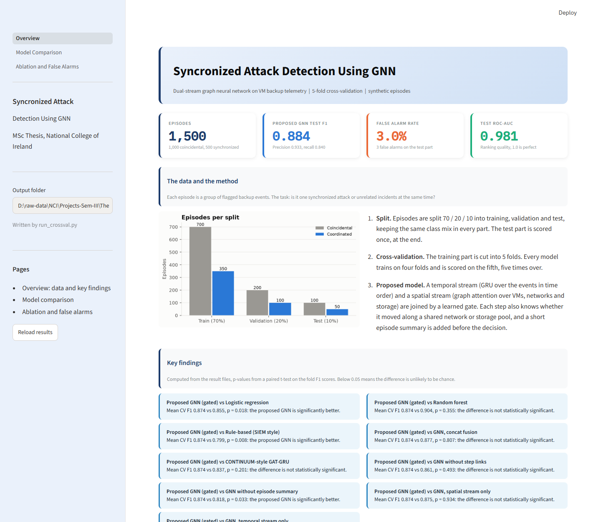
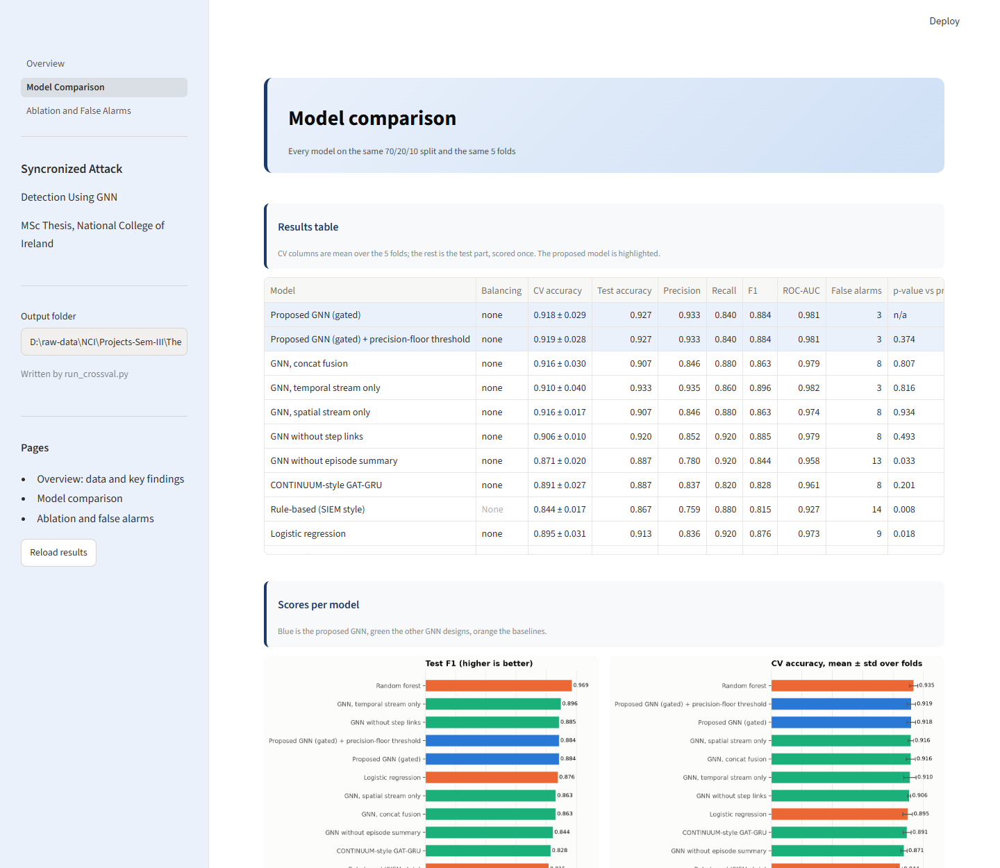
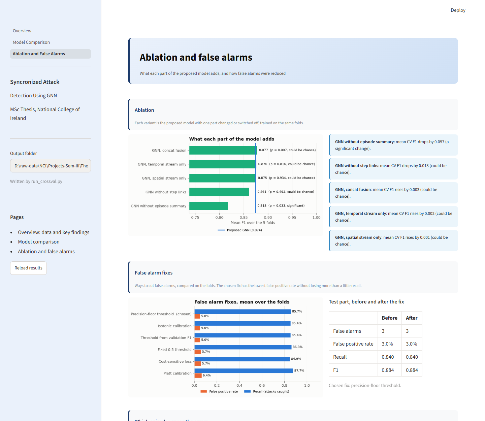
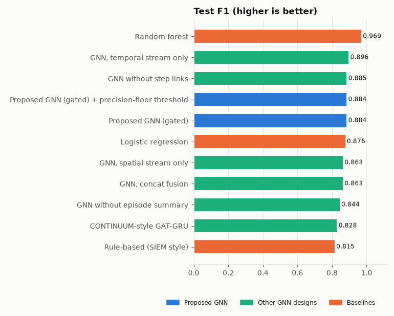
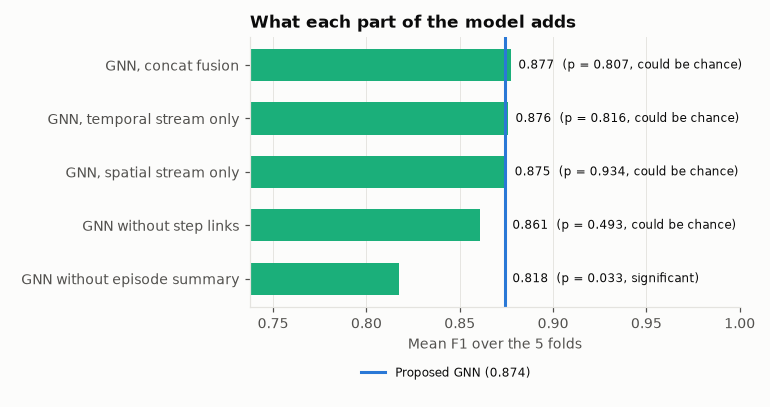
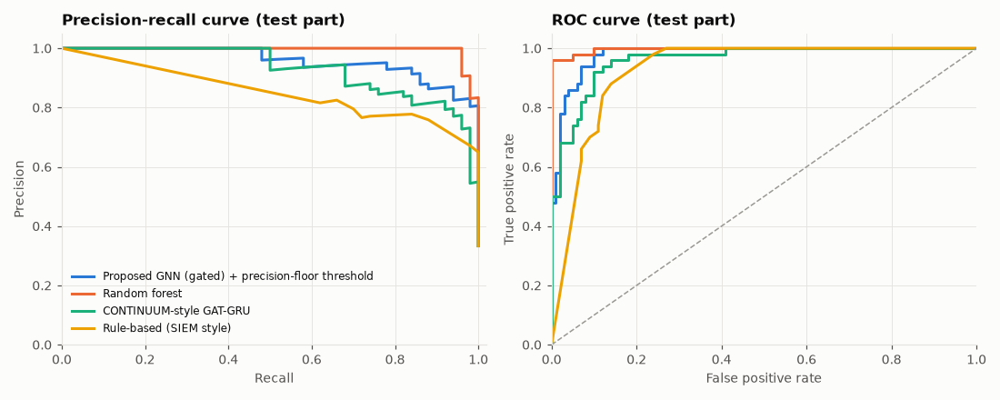
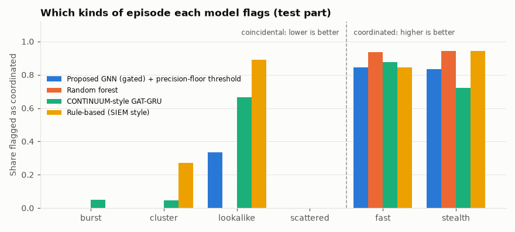
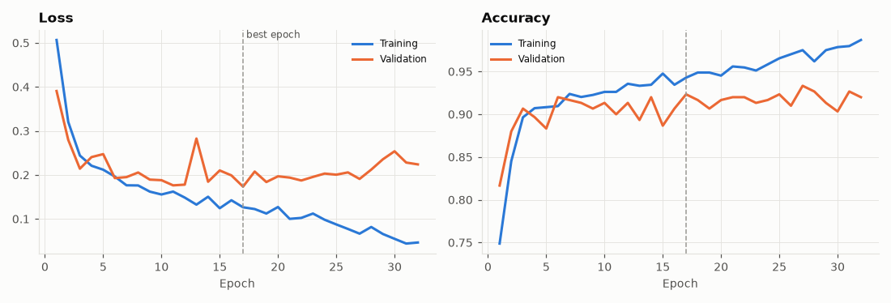

# Syncronized Attack Detection Using GNN

**MSc Data Analytics, National College of Ireland**

A dual-stream graph neural network that looks at a group of suspicious VM backup events and
decides: is this **one syncronized attack** moving through the infrastructure, or **unrelated
incidents** that just happened at the same time?

---

## The problem

Backup anomaly detectors flag single VMs, for example a backup whose files suddenly look
encrypted. In a large enterprise, many VMs get flagged every day. A security analyst then has
to answer a harder question: do some of these alerts belong together?

| | Syncronized attack | Coincidental incidents |
|---|---|---|
| What happens | An attacker spreads from VM to VM | Unrelated VMs have problems |
| Timing | One after another, minutes or hours apart | Random, often spread over days |
| Infrastructure | Each hop uses a shared network or storage pool | VMs on different networks |
| Right response | Contain the whole campaign now | Fix each VM on its own |

Treating a campaign as separate alerts lets the attacker keep moving. Treating coincidence as a
campaign wastes the team's time and causes alert fatigue. So the model must catch campaigns
**and** keep false alarms low.

---

## Our approach

Each group of flagged events (an **episode**) becomes a small graph of VMs, backup images,
storage pools and networks. The model reads it in two ways at once:

```
                 Episode graph (VMs, backups, storage, networks)
                         |                           |
             Temporal stream                   Spatial stream
       GRU over events in time order     Graph attention over the topology
       (+ "did this step use a shared    (who is connected to whom)
          network or storage pool?")
                         |                           |
                         +------ Gated fusion -------+
                                      |
                        + Episode summary (counts, gaps, spread)
                                      |
                       Coordinated or coincidental?
```

- The **gate** learns, for each episode, how much to trust timing versus topology.
- **Step links** connect the two views: an attack moves in time *along* the infrastructure.
- The **episode summary** gives whole-episode numbers that message passing finds hard to count.

The data comes from a synthetic generator calibrated on public ransomware and file system
traces: 1,500 episodes, 1,000 coincidental and 500 syncronized, with hard cases on purpose
(slow campaigns, look-alike patch rollouts, missed events).

---

## Dashboard preview

A Streamlit dashboard shows every result of the study in three pages.

**Overview:** the data, the method and the key findings



**Model comparison:** the results table and scores of every model



**Ablation and false alarms:** what each part adds and how false alarms were reduced



---

## Results

All models use the same 70/20/10 split and the same 5 cross-validation folds. The test part is
scored once, at the end. p-value: paired t-test on the fold F1 scores against the proposed GNN;
below 0.05 means the difference is unlikely to be chance.

| Model | CV accuracy | Test F1 | Test ROC-AUC | False alarms (test) | p-value |
|---|---|---|---|---|---|
| **Proposed GNN** | 0.918 ± 0.029 | 0.884 | 0.981 | 3 | - |
| Random forest | 0.935 ± 0.026 | 0.969 | 0.997 | 0 | 0.355 |
| Logistic regression | 0.895 ± 0.031 | 0.876 | 0.973 | 9 | 0.018 |
| CONTINUUM-style GAT-GRU | 0.891 ± 0.027 | 0.828 | 0.961 | 8 | 0.201 |
| Rule-based (SIEM style) | 0.844 ± 0.017 | 0.815 | 0.927 | 14 | 0.008 |

**In short:**

- The GNN is **significantly better** than logistic regression and the SIEM-style rule.
- The random forest scores higher, but the gap across the folds is **not statistically
  significant** (p = 0.355). It also needs 17 hand-made features; the GNN learns from the raw
  episode graph.
- Removing the episode summary makes the GNN **significantly worse** (p = 0.033), and false
  alarms rise from 3 to 13.





Precision-recall and ROC curves on the test part:



Which kinds of episode each model flags. Coincidental patterns on the left should be low,
syncronized campaigns on the right should be high:



Training and validation curves of the proposed model on one fold:



All episodes are synthetic, so the numbers compare methods on this data and do not measure
performance on real attack campaigns

---

## How to run

```bash
python -m venv .venv
.venv\Scripts\activate       
pip install -r requirements.txt
pip install "streamlit>=1.40" #dashboard
```

```bash
python run_generator.py   # synthetic telemetry
python run_graph_builder.py   #one graph per episode
python run_training.py # training
python run_crossval.py  # Full comparison study (Approx 4-5 hours on normal machine)
python run_evaluation.py # Optional, to validate result
python run_dashboard.py   # open the dashboard (http://localhost:8501/)
```

`run_training.py`, `run_evaluation.py`, `run_baselines.py` and `run_experiments.py` run single
steps on their own.

---

## Project structure

```
configs/   run settings (default.yaml, crossval.yaml, experiments.yaml)
src/cadgnn/   generator, graph builder, model, training, evaluation, baselines, study
dashboard/   Streamlit dashboard
docs/      technical details and README images
tests/       pytest suite
run_*.py     entry points
```

Datasets, configuration options, outputs and every module are described in
[docs/DETAILS.md](docs/DETAILS.md).
